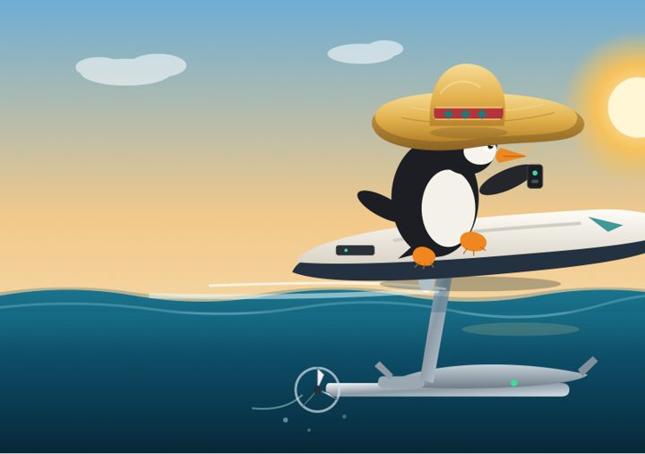
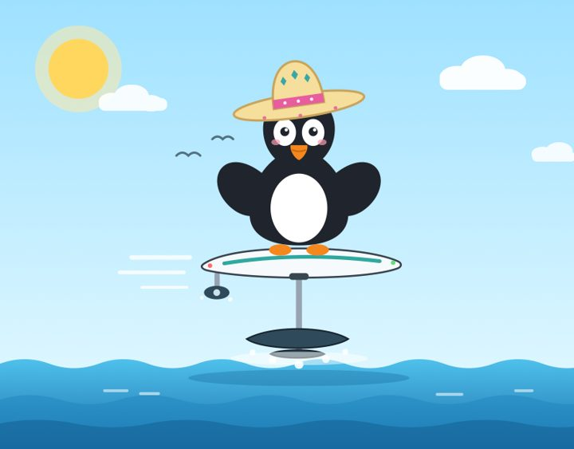

# El Pinguino Benchmark

[Русская версия](penguin-efoil-benchmark/README.ru.md)

My take on Simon Willison's [pelican riding a bicycle](https://github.com/simonw/pelican-bicycle): small, fun prompts that show what AI models can and can't do. **Live site:** https://elpinguinofrio.github.io/el-pinguino-benchmark/

## 🐧 Penguin E-Foil Benchmark

> Generate an SVG of a penguin wearing a sombrero riding an e-foil.

12 models, 44 drawings, every one published. [Gallery](https://elpinguinofrio.github.io/el-pinguino-benchmark/penguin-efoil-benchmark/docs/) · [Русский](https://elpinguinofrio.github.io/el-pinguino-benchmark/penguin-efoil-benchmark/docs/ru/) · [Details](penguin-efoil-benchmark/)

<table>
<tr>
<td align="center"> <b>Claude Opus 5.5</b></td>
<td align="center"> <b>Grok 4.7 Build Fast</b></td>
<td align="center"> <b>Qwen3.8-27B (local)</b></td>
</tr>
</table>

## 🎮 One-Prompt Games

Games an AI model built in a single session. Folder names start with the model and effort.

| Game | Model | Effort | Play |
|---|---|---|---|
| [Voxel Titanic](one-prompt-games/fable-5.2-high-voxel-titanic/) | Fable 5.2 | high | [play](https://elpinguinofrio.github.io/el-pinguino-benchmark/one-prompt-games/fable-5.2-high-voxel-titanic/) |
| [Vibecoder Simulator](one-prompt-games/fable-5.2-high-vibecoder-simulator/) | Fable 5.2 | high | [play](https://elpinguinofrio.github.io/el-pinguino-benchmark/one-prompt-games/fable-5.2-high-vibecoder-simulator/) |
| [Sunset Meadow](one-prompt-games/fable-5.2-high-sunset-meadow/) | Fable 5.2 | high | [play](https://elpinguinofrio.github.io/el-pinguino-benchmark/one-prompt-games/fable-5.2-high-sunset-meadow/) |
| [ASCII Tetris](one-prompt-games/qwen3.8-27b-abliterated-ascii-tetris/) | Qwen3.8-27B abliterated (local) | default | `python3 tetris.py` in a terminal |

ASCII Tetris is unfinished: the agent's file write was blocked, so the code was recovered from its session log and has never been run.
