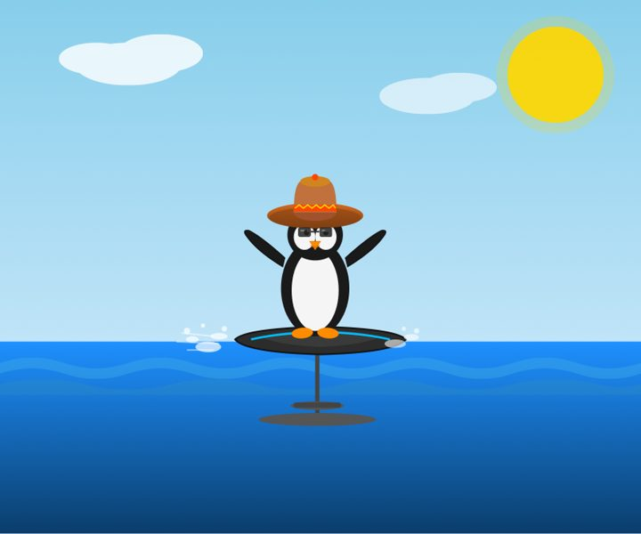
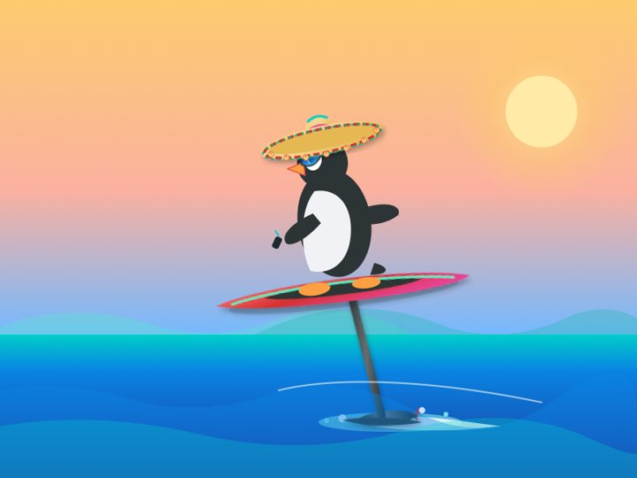

# Penguin E-Foil Benchmark

[English](README.md)

> Generate an SVG of a penguin wearing a sombrero riding an e-foil.

Альтернатива тесту Саймона Уиллисона [«пеликан на велосипеде»](https://github.com/simonw/pelican-bicycle): та же идея, но промпт, которого модели ещё не видели. 12 моделей, 44 рисунка, все без отбора.

<table>
<tr><td align="center"><br><sub><b>Claude Opus 5.5</b> · medium</sub></td><td align="center"><br><sub><b>Claude Sonnet 5.5</b> · medium</sub></td><td align="center"><br><sub><b>Claude Haiku 5.5</b> · medium</sub></td></tr>
<tr><td align="center"><br><sub><b>Claude Opus 4.6</b> · default</sub></td><td align="center"><br><sub><b>Claude Sonnet 4.6</b> · default</sub></td><td align="center"><br><sub><b>Grok 4.7</b> · medium</sub></td></tr>
<tr><td align="center"><br><sub><b>Grok 4.7 Build Fast</b> · medium</sub></td><td align="center"><br><sub><b>Grok 4.6</b> · medium</sub></td><td align="center"><br><sub><b>Grok 4.5</b> · medium</sub></td></tr>
<tr><td align="center"><br><sub><b>Gemini 3.8 Flash</b> · low</sub></td><td align="center"><br><sub><b>GPT-OSS 120B</b> · medium</sub></td><td align="center"><br><sub><b>Qwen3.8-27B abliterated</b> · medium</sub></td></tr>
</table>

## Правила

- Промпт отправляется дословно, одна попытка, без нашего системного промпта.
- Средний уровень рассуждений (medium), где он настраивается. Три прогона на модель.
- Публикуется каждый рисунок. Неудачные попытки лежат в `runs/_failures/`.
- Каждый SVG проверяется на скрипты и ссылки до рендера.

## Добавить модель

```bash
python3 scripts/run_openai_compat.py --slug <model> --base-url http://127.0.0.1:8000/v1 --model <id> --run 1
python3 scripts/scan_svg.py
python3 scripts/render.py        # macOS
python3 scripts/build_site.py
```

Или положите `runs/<model>/medium_run1.svg` и `.json` вручную. Добавьте `model.json` и имя папки в `model_order` в `benchmark.json`.

## Файлы

```
benchmark.json        промпт, порядок моделей, тексты страницы (EN/RU)
runs/<model>/         SVG, рендер, метаданные и ответ модели для каждого прогона
docs/                 сгенерированная галерея (GitHub Pages)
```

Лицензия MIT. Вдохновлено [simonw/pelican-bicycle](https://github.com/simonw/pelican-bicycle).
